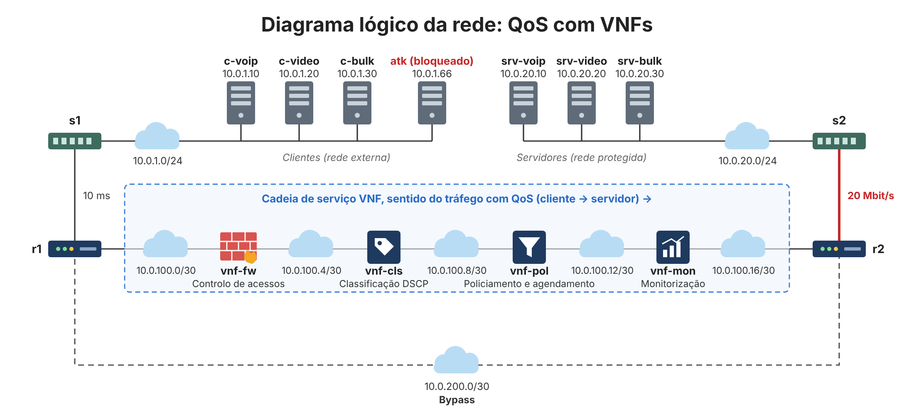
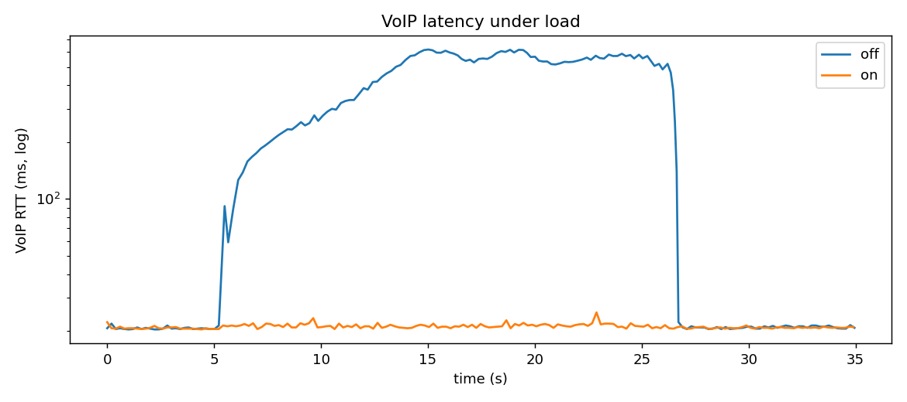

# QoS with Virtual Network Functions

QoS system built from VNFs on an emulated network in [CORE](https://github.com/coreemu/core). Client traffic goes through a chain of four Docker containers (firewall, classifier, policer/scheduler and monitor) before reaching the servers, and we measure what that does to latency, jitter, throughput and loss when the network is congested.

Practical assignment 3 for Qualidade de Serviço na Internet, MSc in Informatics Engineering, University of Minho, 2026/2027 (group 9).



## Topology

Clients and an attacker (`atk`) are on the left, servers on the right. The `r2`–`s2` link is limited to 20 Mbit/s and is where congestion happens; `r1`–`s1` adds 10 ms of delay. Traffic can go through the VNF chain or over a direct bypass link between the routers, so we can compare both.

| Segment | Network | Nodes |
| --- | --- | --- |
| Clients (s1) | 10.0.1.0/24 | c-voip .10 · c-video .20 · c-bulk .30 · atk .66 · r1 .1 |
| Servers (s2) | 10.0.20.0/24 | srv-voip .10 · srv-video .20 · srv-bulk .30 · r2 .1 |
| VNF chain | 10.0.100.0/30 … 10.0.100.16/30 | r1 → fw → cls → pol → mon → r2 |
| Bypass | 10.0.200.0/30 | r1 ↔ r2 |

Routing is static, set by the orchestrator.

## VNFs

| # | VNF | Function | How |
| --- | --- | --- | --- |
| 1 | `vnf-fw` | Access control | Stateful whitelist with `iptables`, everything else dropped; allowed/dropped flows logged through NFLOG |
| 2 | `vnf-cls` | Classification | Scapy gets new flows via NFQUEUE and decides the class, either by rules or with an ML model (see below); the decision is saved with `CONNMARK` and `iptables` sets the DSCP on the rest of the flow |
| 3 | `vnf-pol` | Policing and scheduling | `tc` HTB at 19 Mbit/s with a guaranteed rate, ceiling and priority per class (`pfifo` for VoIP/video, `fq_codel` for bulk) |
| 4 | `vnf-mon` | Monitoring | Counts packets per DSCP class; exports to Prometheus (`:9100`) / Grafana and writes a CSV every second |

The policer shapes slightly below the 20 Mbit/s link so the queue forms in `vnf-pol`, where it can be prioritised, instead of in the router.

| Class | Traffic | Generated with | DSCP | HTB rate / ceil | Priority |
| --- | --- | --- | --- | --- | --- |
| VoIP | real-time | `ping` | EF (46) | 1 / 19 Mbit/s | 0 |
| Video | streaming | `iperf3` UDP | AF31 (26) | 9 / 19 Mbit/s | 1 |
| Bulk | best effort | `iperf3` TCP | DF (0) | 9 / 19 Mbit/s | 2 |

The bulk ceiling can be lowered with `BULK_CEIL` (e.g. `12mbit`) to police it harder.

## ML classification

Besides the rules (ICMP → VoIP, UDP → video, TCP → bulk), the classifier has an ML mode that looks at how a flow behaves instead of its protocol or ports. It watches the first 8 packets of each flow (or less if the flow is slow, after 1 s) and a scikit-learn decision tree picks the class from 13 features: protocol, packet sizes, inter-arrival times and rate. IPs and ports are not used. While a flow is being watched its packets go as best effort; after that it gets its DSCP like in rules mode.

The mode can be switched while traffic is running, without restarting the VNF:

```bash
docker exec vnf-cls python3 /app/vnf.py mode ml        # or rules / collect
```

The default model is trained when the image is built, on synthetic flows (RTP codecs, pings, iperf3, frame-based video, TCP uploads, QUIC-like bulk, control connections). We compared a decision tree with a random forest on 3000 flows:

| Model | Holdout accuracy | 5-fold CV | Time per flow |
| --- | ---: | ---: | ---: |
| Decision tree | 99.9 % | 99.4 % ± 0.1 | ~0.17 ms |
| Random forest | 99.9 % | 99.9 % ± 0.1 | ~10 ms |

We kept the tree: same accuracy, ~60× faster, and it can be printed as rules.

The model can also be retrained with real traffic from the lab. In `collect` mode the VNF uses the rules but records every flow with its real class (taken from the server it goes to), and `vnf.py train` retrains with that data; the VNF loads the new model by itself. `tests/cls_accuracy.py` runs the same random traffic in rules and ML mode and compares accuracy, precision and recall per class. More details in [vnfs/cls/ml/README.md](vnfs/cls/ml/README.md) (in Portuguese).

## Results

Run with `tests/run_tests.py`: VoIP pings every 0.2 s for 35 s, 8 Mbit/s UDP video for 30 s, and 4 TCP bulk streams starting at 5 s, which saturates the 20 Mbit/s link. "Off" is the same path with the VNFs disabled (the bypass gives the same numbers).

| Metric | VNFs off | VNFs on |
| --- | ---: | ---: |
| Attacker blocked | no | yes |
| VoIP RTT avg | 278 ms | 21.1 ms |
| VoIP RTT p95 | 600 ms | 22.0 ms |
| VoIP jitter | 11.9 ms | 0.44 ms |
| VoIP loss | 0 % | 0 % |
| Video throughput | 8.0 Mbit/s | 8.0 Mbit/s |
| Video loss | 0.09 % | 0 % |
| Bulk throughput | 9.4 Mbit/s | 10.1 Mbit/s |



Without the VNFs, VoIP shares the queue with bulk TCP and its RTT goes up to ~600 ms as soon as the bulk streams start. With the chain on it stays around 21 ms the whole time.


With 16 Mbit/s of video (more than its share) VoIP is still protected, but video takes the losses:

| 16 Mbit/s video | VNFs off | VNFs on |
| --- | ---: | ---: |
| VoIP RTT avg | 362 ms | 21.2 ms |
| Video loss | 0.3 % | 25.4 % |
| Bulk throughput | 3.6 Mbit/s | 8.3 Mbit/s |

Single runs; use `--runs N` to average several.

## How to run

Needs Ubuntu (VM, or WSL 2 with systemd) with CORE installed. `setup.sh` installs the rest (Docker, Compose, iperf3, tcpdump, matplotlib).

```bash
sudo bash setup.sh             # once: packages, Docker, kernel modules, VNF images
sudo docker compose up -d      # Prometheus + Grafana
```

Open `topology/chain.xml` in `core-gui`, press play, then:

```bash
sudo python3 orchestrator/qosi.py chain     # through the VNFs
sudo python3 orchestrator/qosi.py bypass    # direct link
```

The routes are lost every time the CORE session restarts, so run it again after each play. If CORE says a name like `vnf-fw` is already in use, remove the old containers (`sudo docker rm -f vnf-fw vnf-cls vnf-pol vnf-mon`) and press play again.

Each VNF is controlled the same way:

```bash
docker exec vnf-fw  python3 /app/vnf.py on | off | status | logs
docker exec vnf-cls python3 /app/vnf.py on [rules|ml|collect] | off | status | mode [rules|ml|collect] | train | logs
docker exec vnf-pol python3 /app/vnf.py on | off | status | logs
docker exec vnf-mon python3 /app/vnf.py on | off | status | metrics | logs
```

Grafana is at <http://localhost:3000>.

### Tests and experiments

```bash
sudo bash vnfs/fw/test.sh      # isolated test of each VNF
sudo bash vnfs/cls/test.sh     # rules + ml (or just: rules | ml)
sudo bash vnfs/pol/test.sh
sudo bash vnfs/mon/test.sh

sudo python3 tests/run_tests.py --name final --runs 3        # bypass / off / on

sudo python3 tests/phase3.py --name load --video 4M 8M 12M 16M
sudo python3 tests/phase3.py --name wan  --delay 0ms 40ms --jitter 0ms 15ms --loss 0% 2% --scenarios off on
sudo python3 tests/phase3.py --name tune --scenarios on --bulk-ceil 10mbit 14mbit 19mbit

sudo python3 tests/traffic.py --duration 300 --seed 42 --atk  # random traffic
sudo python3 tests/cls_accuracy.py --duration 300 --seed 42   # rules vs ML accuracy
```

Results are saved in `results/<name>/` (CSV summaries, graphs and raw ping/iperf3/mon data).

## Repository

```text
setup.sh                 machine setup
docker-compose.yml       VNF image builds, Prometheus and Grafana
topology/chain.xml       CORE topology
orchestrator/qosi.py     routes: chain | bypass
vnfs/base/               shared base image
vnfs/fw|cls|pol|mon/     each VNF: vnf.py, test.sh, Dockerfile
vnfs/cls/ml/             ML classifier: features, synthetic flows, training, model loading
tests/                   scenario runner, sweeps, random traffic, classifier accuracy
docs/                    diagram, Gantt, screenshots, graphs, progress report
```

## Authors

| Name | Number |
| --- | --- |
| Luís Lopes | PG64182 |
| Paulo Brochado | PG64183 |
| Vítor Mina | PG64044 |
