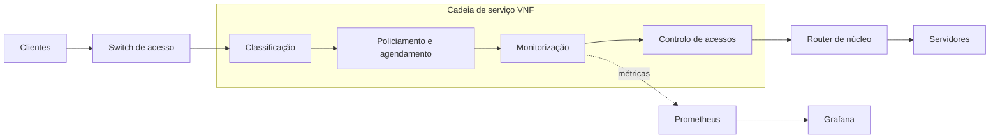

# Mecanismos de QoS com VNFs

Sistema de Qualidade de Serviço (QoS) construído com Funções de Rede Virtualizadas (VNFs). Numa rede emulada semelhante à de um ISP, o tráfego atravessa uma cadeia de VNFs que o classifica, limita, prioriza, filtra e monitoriza. O objetivo é medir o impacto dessa cadeia na latência, no jitter, no débito e na perda de pacotes.

Trabalho Prático 3 da unidade curricular **Qualidade de Serviço na Internet** da Universidade do Minho, ano letivo 2026/2027.

> **Estado:** em desenvolvimento. A estrutura, os comandos e os parâmetros abaixo descrevem o plano do projeto e serão atualizados à medida que a implementação avança.

## Objetivos

- Virtualizar funções de QoS tradicionalmente implementadas em hardware dedicado.
- Aplicar classificação, controlo de acessos, policiamento, agendamento e monitorização numa rede emulada.
- Comparar as métricas de rede com e sem a cadeia de VNFs.
- Documentar as contrapartidas de cada configuração, por exemplo entre débito total e equidade.

## Arquitetura

O tráfego entra pela rede de acesso, atravessa a cadeia de serviço e segue para o núcleo da rede:



### VNFs

| VNF | Função | Tecnologia |
| --- | --- | --- |
| Classificação | Identifica o tráfego e marca o campo DSCP | Python com Scapy ou Open vSwitch |
| Policiamento e agendamento | Limita o débito com token bucket e gere as filas por prioridade | `tc` do Linux em Docker |
| Monitorização | Recolhe métricas de tráfego e de desempenho | sFlow, Prometheus e Grafana |
| Controlo de acessos | Bloqueia tráfego não autorizado | `nftables` |

### Classes de tráfego

As marcações seguem as recomendações do [RFC 4594](https://www.rfc-editor.org/rfc/rfc4594):

| Classe | Exemplo | Requisito principal | DSCP | Prioridade |
| --- | --- | --- | --- | --- |
| Tempo real | VoIP | Baixa latência e baixo jitter | EF (46) | Alta |
| Multimédia | Streaming de vídeo | Largura de banda elevada | AF31 (26) | Média |
| Best effort | Transferência de dados em massa | Sem garantias | DF (0) | Baixa |

## Tecnologias

| Área | Ferramentas |
| --- | --- |
| Emulação de rede | [Containernet](https://github.com/containernet/containernet) (Mininet com suporte a Docker) e Open vSwitch |
| VNFs | Docker, Python, Scapy, `tc` e `nftables` |
| Geração de tráfego | `iperf3`, D-ITG e Scapy |
| Monitorização | sFlow, Prometheus e Grafana |

Todas as ferramentas são gratuitas e de código aberto.

## Estrutura do repositório

```text
.
├── topology/       # Definição da rede emulada
├── vnfs/           # Uma pasta por VNF, com Dockerfile e configuração
│   ├── classifier/
│   ├── policer/
│   ├── firewall/
│   └── monitor/
├── monitoring/     # Prometheus e dashboards do Grafana
├── scenarios/      # Cenários de tráfego e de congestionamento
├── scripts/        # Instalação, execução e análise
├── results/        # Dados e gráficos das experiências
└── docs/           # Proposta, relatórios e diagramas
```

## Como executar

### Requisitos

- Máquina virtual Ubuntu 22.04 LTS, por exemplo em VirtualBox ou AWS EC2
- [Containernet](https://github.com/containernet/containernet#installation)
- Docker e Docker Compose
- Python 3

Os comandos usam privilégios de administrador porque criam interfaces e regras de rede. Execute-os apenas dentro da máquina virtual.

### Instalação

Clone o repositório:

```bash
git clone https://github.com/<utilizador>/<repositorio>.git
```

```bash
cd <repositorio>
```

Instale as ferramentas de tráfego e as dependências:

```bash
sudo apt install -y iperf3 d-itg python3-scapy
```

Construa as imagens das VNFs:

```bash
./scripts/build_vnfs.sh
```

### Execução

Inicie a monitorização:

```bash
docker compose -f monitoring/docker-compose.yml up -d
```

Inicie a topologia e a cadeia de VNFs:

```bash
sudo python3 topology/topology.py
```

Num segundo terminal, execute um cenário de tráfego:

```bash
sudo ./scripts/run_scenario.sh scenarios/voip_video_bulk.yml
```

Abra o Grafana em <http://localhost:3000> para acompanhar as métricas.

### Limpeza

Remova a topologia e as interfaces criadas pelo Mininet:

```bash
sudo mn -c
```

Pare a monitorização:

```bash
docker compose -f monitoring/docker-compose.yml down
```

## Experiências

Cada cenário é executado com e sem a cadeia de VNFs, para que os resultados possam ser comparados diretamente:

| Cenário | O que varia | O que se pretende observar |
| --- | --- | --- |
| Referência | Rede sem VNFs nem congestionamento | Valores de base das métricas |
| Congestionamento | Carga total acima da capacidade da ligação | Proteção do tráfego VoIP face ao tráfego em massa |
| Cargas variáveis | Proporção entre as três classes de tráfego | Evolução da latência em função da carga |
| Falhas | Atraso e perda introduzidos com `tc netem` | Comportamento das classes em condições degradadas |
| Otimização | Pesos das filas e limites de débito | Equilíbrio entre débito total e equidade |

## Resultados

Ainda não existem resultados. Os dados e os gráficos ficarão em [`results/`](results/) e a análise completa será incluída no relatório final.

## Progresso

- [ ] Fase 1: ambiente, topologia e proposta

- Diagrama da Rede


| Elemento | Descrição |
| --- | --- |
| r1,r2 | Hosts do Mininet com encaminhamento IP ativo | 
|s1, s2 | Switches virtuais Open vSwitch |
| VNFs | Contentores Docker |
| Servidores, clientes e atk | Hosts emulados |
| Ligações | Pares de interfaces virtuais (veth), com débito e atraso definidos por software |


- [ ] Fase 2: implementação e teste individual das VNFs
- [ ] Fase 3: integração, testes e otimização
- [ ] Fase 4: experiências, análise e relatório final

## Entregas

| Entrega | Ligação |
| --- | --- |
| Proposta | *A adicionar* |
| Relatório de progresso | *A adicionar* |
| Relatório final | *A adicionar* |
| Vídeo de demonstração | *A adicionar* |

## Segurança e ética

Todo o tráfego é gerado num ambiente emulado e isolado. Não execute estes cenários em redes reais sem autorização.

## Autores

| Nome | Número | GitHub |
| --- | --- | --- |
| *Nome* | *A00000* | *@utilizador* |

O registo das contribuições de cada elemento do grupo está disponível no [histórico de commits](../../commits).

## Referências

- ETSI, [Network Functions Virtualisation (NFV)](https://www.etsi.org/technologies/nfv)
- RFC 2474, [Definition of the Differentiated Services Field](https://www.rfc-editor.org/rfc/rfc2474)
- RFC 2475, [An Architecture for Differentiated Services](https://www.rfc-editor.org/rfc/rfc2475)
- RFC 4594, [Configuration Guidelines for DiffServ Service Classes](https://www.rfc-editor.org/rfc/rfc4594)
