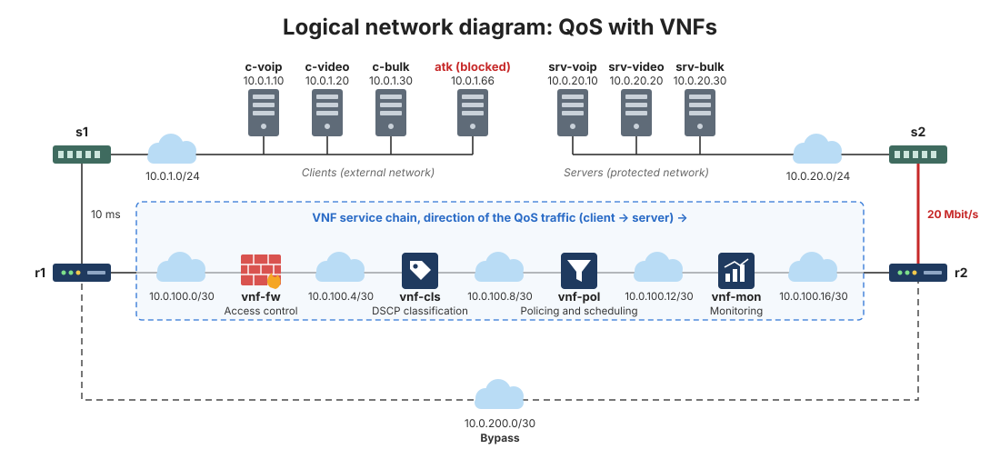
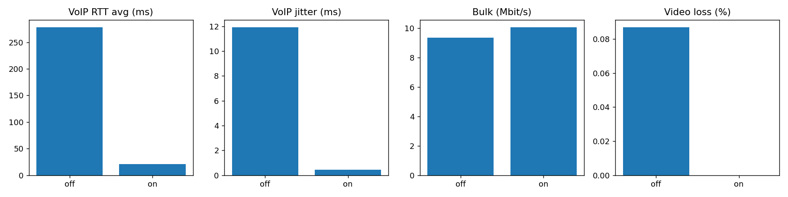

# QoS with Virtual Network Functions

QoS system built from VNFs on an emulated network in [CORE](https://github.com/coreemu/core). Client traffic goes through a chain of four Docker containers (firewall, classifier, policer/scheduler and monitor) before reaching the servers, and we measure what that does to latency, jitter, throughput and loss when the network is congested.

Practical assignment 3 for Qualidade de Serviço na Internet, MSc in Informatics Engineering, University of Minho, 2026/2027 (group 9).



## Topology

Clients and an attacker (`atk`) are on the left, servers on the right. The `r2`–`s2` link is limited to 20 Mbit/s and is where congestion happens; `r1`–`s1` adds 10 ms of delay. Traffic can go through the VNF chain or over a direct bypass link between the routers, so we can compare both.

| Segment | Network | Nodes |
| --- | --- | --- |
| Clients (s1) | 10.0.1.0/24 | c-voip .10 · c-video .20 · c-bulk .30 · atk .66 · r1 .1 |
| Servers (s2) | 10.0.20.0/24 | srv-voip .10 · srv-video .20 · srv-bulk .30 · r2 .1 |
| VNF chain | 10.0.100.0/30 … 10.0.100.16/30 | r1 → fw → cls → pol → mon → r2 |
| Bypass | 10.0.200.0/30 | r1 ↔ r2 |

Routing is static and needs no setup: r1 and r2 get their routes from CORE's StaticRoute service in the topology, and each VNF sets its own two routes when it starts (`vnfs/base/chain-routes.sh`). Traffic goes through the chain as soon as the session starts.

## VNFs

| # | VNF | Function | How |
| --- | --- | --- | --- |
| 1 | `vnf-fw` | Access control | Stateful whitelist with `iptables`, everything else dropped; allowed/dropped flows logged through NFLOG |
| 2 | `vnf-cls` | Classification | Scapy gets new flows via NFQUEUE and decides the class, either by rules or with an ML model (see below); the decision is saved with `CONNMARK` and `iptables` sets the DSCP on the rest of the flow |
| 3 | `vnf-pol` | Policing and scheduling | `tc` HTB at 19 Mbit/s with a guaranteed rate, ceiling and priority per class (`pfifo` for VoIP/video, `fq_codel` for bulk) |
| 4 | `vnf-mon` | Monitoring | Counts packets per DSCP class after the chain and writes a CSV every second |

The policer shapes slightly below the 20 Mbit/s link so the queue forms in `vnf-pol`, where it can be prioritised, instead of in the router.

| Class | Traffic | Generated with | DSCP | HTB rate / ceil | Priority |
| --- | --- | --- | --- | --- | --- |
| VoIP | real-time | `ping` | EF (46) | 1 / 19 Mbit/s | 0 |
| Video | streaming | `iperf3` UDP | AF31 (26) | 9 / 19 Mbit/s | 1 |
| Bulk | best effort | `iperf3` TCP | DF (0) | 9 / 19 Mbit/s | 2 |

The bulk ceiling can be lowered with `BULK_CEIL` (e.g. `12mbit`) to police it harder.

## ML classification

Besides the rules (ICMP → VoIP, UDP → video, TCP → bulk), the classifier has an ML mode that looks at how a flow behaves instead of its protocol or ports. It watches the first 8 packets of each flow (or fewer if the flow is slow, after 1 s) and a scikit-learn decision tree picks the class from 13 features: protocol, packet sizes (mean, deviation, min, max, share of small and large packets), inter-arrival times (mean, deviation, max) and rate. IPs and ports are not used. While a flow is being watched its packets go as best effort; after that it gets its DSCP like in rules mode.

### Modes

The mode can be switched while traffic is running, without restarting the VNF (inside a VNF terminal, `clsmode ml` does the same):

```bash
docker exec vnf-cls python3 /app/vnf.py mode            # current mode
docker exec vnf-cls python3 /app/vnf.py mode ml         # decision tree
docker exec vnf-cls python3 /app/vnf.py mode rules      # protocol rules, decided on the first packet
docker exec vnf-cls python3 /app/vnf.py mode collect    # rules, and records every flow for training
```

Switching clears the VNF's connection tracking, so flows that are already running are classified again in the new mode.

### Model

The image trains the model when it is built, on synthetic flows (RTP with several codecs, pings, iperf3, frame-based video, TCP uploads, QUIC-like bulk, control connections) plus any lab data in `vnfs/cls/ml/data/`. Each training run compares a decision tree with a random forest on a 25 % holdout and with 5-fold cross-validation:

| Model | Holdout accuracy | 5-fold CV | Time per flow |
| --- | ---: | ---: | ---: |
| Decision tree | 99.9 % | 99.4 % ± 0.1 | ~0.15 ms |
| Random forest | 99.9 % | 99.9 % ± 0.1 | ~6–10 ms |

We kept the tree: same accuracy, about 40–60× faster per flow, and it can be printed as rules (`train.py` shows it).

### Results on lab traffic

`tests/cls_accuracy.py` runs the same random traffic (300 s, seed 42) in rules and in ML mode and checks every decision against the server each flow went to:

| Mode | Flows | Accuracy | VoIP F1 | Video F1 | Bulk F1 | VoIP RTT avg |
| --- | ---: | ---: | ---: | ---: | ---: | ---: |
| Rules | 86 | 100 % | 1.00 | 1.00 | 1.00 | 21.5–22.2 ms |
| ML | 86 | 100 % | 1.00 | 1.00 | 1.00 | 21.4–22.0 ms |

In this lab each application uses a different protocol, so the rules can't get it wrong. The point is that the model matches them without looking at protocol rules, ports or addresses, and that watching the first packets of each flow doesn't cost VoIP any latency. The synthetic flows are where protocol alone isn't enough (e.g. voice and video both over UDP, video and file uploads both over TCP).

### Retraining with lab traffic

In `collect` mode the VNF keeps classifying with the rules and records every flow with its features and true class; `train` retrains on synthetic plus recorded flows, and the VNF loads the new model by itself:

```bash
docker exec vnf-cls python3 /app/vnf.py mode collect
sudo python3 tests/traffic.py --duration 300
docker exec vnf-cls python3 /app/vnf.py train
docker exec vnf-cls python3 /app/vnf.py status          # model accuracy and live accuracy per mode
```

With 180 lab flows added to the 3000 synthetic ones, the tree classified all 43 lab flows in the holdout correctly (99.9 % overall, CV 99.7 % ± 0.3). It also shows what training data does: protocol went from a minor feature to the second most important one (importance 0.05 → 0.20), because in this lab it separates the classes perfectly.

CORE recreates the container on every play, so to keep the lab data it goes into the repository, and every image build then trains on it:

```bash
docker cp vnf-cls:/var/log/cls.flows.csv vnfs/cls/ml/data/lab_$(date +%F).csv
sudo docker compose build cls
```

### Code

| File (`vnfs/cls/ml/`) | What it does |
| --- | --- |
| `features.py` | per-flow window (8 packets or 1 s) and the 13 features |
| `synth.py` | synthetic flow generator, cut by the same rule the VNF uses to decide |
| `train.py` | trains and compares the models, prints the report, confusion matrix and tree, saves `model.joblib` and `model.meta.json` |
| `model.py` | loads the model and reloads it when the file changes |
| `data/` | lab flows recorded in `collect` mode, used when the image is built |

## Results

Run with `tests/run_tests.py`: VoIP pings every 0.2 s for 35 s, 8 Mbit/s UDP video for 30 s, and 4 TCP bulk streams starting at 5 s, which saturates the 20 Mbit/s link. "Off" is the same path with the VNFs disabled (the bypass gives the same numbers).

| Metric | VNFs off | VNFs on |
| --- | ---: | ---: |
| Attacker blocked | no | yes |
| VoIP RTT avg | 278 ms | 21.1 ms |
| VoIP RTT p95 | 600 ms | 22.0 ms |
| VoIP jitter | 11.9 ms | 0.44 ms |
| VoIP loss | 0 % | 0 % |
| Video throughput | 8.0 Mbit/s | 8.0 Mbit/s |
| Video loss | 0.09 % | 0 % |
| Bulk throughput | 9.4 Mbit/s | 10.1 Mbit/s |


Without the VNFs, VoIP shares the queue with bulk TCP and its RTT goes up to ~600 ms as soon as the bulk streams start. With the chain on it stays around 21 ms the whole time.



With 16 Mbit/s of video (more than its share) VoIP is still protected, but video takes the losses:

| 16 Mbit/s video | VNFs off | VNFs on |
| --- | ---: | ---: |
| VoIP RTT avg | 362 ms | 21.2 ms |
| Video loss | 0.3 % | 25.4 % |
| Bulk throughput | 3.6 Mbit/s | 8.3 Mbit/s |

Single runs; use `--runs N` to average several.

## How to run

Needs a fresh Ubuntu 22.04 or newer (VM, or WSL 2 with systemd). One script installs and sets up everything: CORE 9.2.1, Docker and Compose, iperf3, tcpdump, the kernel modules, the VNF images, and Prometheus and Grafana.

```bash
sudo bash setup.sh             # once; safe to re-run

# later, after changing a VNF's code:
sudo docker compose build cls  # rebuild one VNF image (or no name for all)
sudo docker compose up -d      # (re)start Prometheus and Grafana
```

Open `topology/chain.xml` in `core-gui` and press play. That's it: traffic already goes through the VNF chain (a session hook in `chain.xml` also allows forwarding on the host).

If a session didn't shut down cleanly, the next play can fail with "container name already in use" or "File exists". Clean up and press play again:

```bash
sudo docker rm -f vnf-fw vnf-cls vnf-pol vnf-mon
for i in $(ip -o link | grep -o 'beth[0-9.]*' | sort -u); do sudo ip link del $i; done
```

To compare with the direct link, switch the path (the test scripts do this by themselves):

```bash
sudo python3 orchestrator/qosi.py bypass    # direct link r1 <-> r2
sudo python3 orchestrator/qosi.py chain     # back through the VNFs
```

Each VNF is controlled the same way:

```bash
docker exec vnf-fw  python3 /app/vnf.py on | off | status | logs
docker exec vnf-cls python3 /app/vnf.py on [rules|ml|collect] | off | status | mode [rules|ml|collect] | train | logs
docker exec vnf-pol python3 /app/vnf.py on | off | status | logs
docker exec vnf-mon python3 /app/vnf.py on | off | status | metrics | logs
```

Grafana is at <http://localhost:3000>. Every VNF exports its own metrics to Prometheus (`:9100`, over CORE's control network), and a single dashboard shows them by QoS aspect: VNF status and bottleneck use, throughput and packets per class after the chain, firewall allowed/dropped packets and new flows, classifier marking, flows per class and ML live accuracy, and the policer's per-class rate, drops and queue backlog.

### Tests and experiments

```bash
sudo bash vnfs/fw/test.sh      # isolated test of each VNF
sudo bash vnfs/cls/test.sh     # rules + ml (or just: rules | ml)
sudo bash vnfs/pol/test.sh
sudo bash vnfs/mon/test.sh

sudo python3 tests/run_tests.py --name final --runs 3        # bypass / off / on

sudo python3 tests/phase3.py --name load --video 4M 8M 12M 16M
sudo python3 tests/phase3.py --name wan  --delay 0ms 40ms --jitter 0ms 15ms --loss 0% 2% --scenarios off on
sudo python3 tests/phase3.py --name tune --scenarios on --bulk-ceil 10mbit 14mbit 19mbit

sudo python3 tests/traffic.py --duration 300 --seed 42 --atk  # random traffic
sudo python3 tests/cls_accuracy.py --duration 300 --seed 42   # rules vs ML accuracy
```

Results are saved in `results/<name>/` (CSV summaries, graphs and raw ping/iperf3/mon data).

## Repository

```text
setup.sh                 machine setup
docker-compose.yml       VNF image builds, Prometheus and Grafana
topology/chain.xml       CORE topology
orchestrator/qosi.py     switch path: chain | bypass
vnfs/base/               shared base image
vnfs/fw|cls|pol|mon/     each VNF: vnf.py, test.sh, Dockerfile
vnfs/cls/ml/             ML classifier (see ML classification above) and lab training data
tests/                   scenario runner, sweeps, random traffic, classifier accuracy
docs/                    diagrams, Gantt, screenshots, graphs, assignment and progress report
```

## Authors

| Name | Number |
| --- | --- |
| Luís Lopes | PG64182 |
| Paulo Brochado | PG64183 |
| Vítor Mina | PG64044 |
